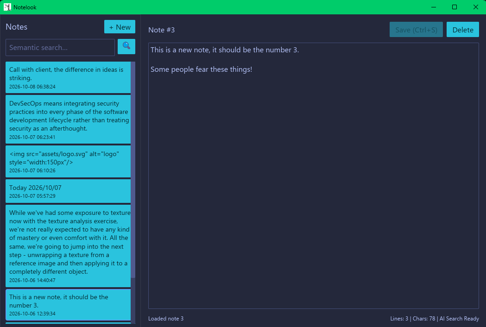

<a id="readme-top"></a>

<!-- PROJECT SHIELDS -->
[![Contributors][contributors-shield]][contributors-url]
[![Forks][forks-shield]][forks-url]
[![Stargazers][stars-shield]][stars-url]
[![Issues][issues-shield]][issues-url]
[![Unlicense License][license-shield]][license-url]


<!-- PROJECT LOGO -->
<br />
<div align="center">
  <a href="https://github.com/AlbertKurtz/notelook">
    
  </a>

<h3 align="center">NoteLook</h3>

  <p align="center">
    A lightweight, portable note-taking app with semantic memory and hybrid search.
    <br />
    <a href="https://github.com/AlbertKurtz/notelook/issues/new?labels=bug&template=bug-report---.md">Report Bug</a>
    &middot;
    <a href="https://github.com/AlbertKurtz/notelook/issues/new?labels=enhancement&template=feature-request---.md">Request Feature</a>
  </p>
</div>


<!-- TABLE OF CONTENTS -->
<details>
  <summary>Table of Contents</summary>
  <ol>
    <li>
      <a href="#about-the-project">About The Project</a>
      <ul>
        <li><a href="#key-features">Key Features</a></li>
        <li><a href="#built-with">Built With</a></li>
      </ul>
    </li>
    <li>
      <a href="#getting-started">Getting Started</a>
      <ul>
        <li><a href="#prerequisites">Prerequisites</a></li>
        <li><a href="#installation">Installation</a></li>
      </ul>
    </li>
    <li><a href="#usage">Usage</a>
      <ul>
        <li><a href="#gui-application">GUI Application</a></li>
        <li><a href="#cli-tool">CLI Tool</a></li>
        <li><a href="#keyboard-shortcuts">Keyboard Shortcuts</a></li>
      </ul>
    </li>
    <li><a href="#architecture">Architecture</a></li>
    <li><a href="#roadmap">Roadmap</a></li>
    <li><a href="#contributing">Contributing</a></li>
    <li><a href="#license">License</a></li>
    <li><a href="#acknowledgments">Acknowledgments</a></li>
  </ol>
</details>


<!-- ABOUT THE PROJECT -->

## About The Project

How often, while working or at the computer, do you find yourself taking quick notes in basic editors like Windows
Notepad, Gedit, or whatever? Writing down dates, tasks, or bullet points during a meeting to remember what to say?
I do it every day.

The problem begins when you need to retrieve those thoughts weeks or months later. You need that exact keywords,
maybe the date, and text search falls short if you can't recall the specific wording. Or you did not even save the note...

**NoteLook** tries to solve this. It preserves the instant feel of a minimalist notepad, but adds semantic
memory.

<div align="center">
  
</div>

NoteLook is a simple project bringing together three core goals:

1. **Rust**: Building an efficient, low-footprint desktop application using modern Rust patterns.
2. **Local Natural Language Processing**: Integrating offline, CPU-friendly embeddings without relying on third-party
   cloud APIs.
3. **A Notepad with Memory**: Creating a fast, local note-taking tool that understands both exact keywords and
   conceptual meaning.

<p align="right">(<a href="#readme-top">back to top</a>)</p>

### Key Features

* **Lightweight Footprint**: Designed to remain fast and portable without bloat.
* **Hybrid Search (Vector + Lexical)**: Fuses dense semantic vector embeddings with native
  full-text retrieval using Reciprocal Rank Fusion (RRF).
* **Token-Aware Markdown Chunking**: Automatically splits long Markdown documents into chunks.
* **100% Local & Offline**: All inference runs locally via Hugging Face Candle on CPU: the notes never leave the machine.
* **Dual Interface**: Includes both desktop GUI and a CLI for scriptable ingestion and terminal queries.

<p align="right">(<a href="#readme-top">back to top</a>)</p>

### Built With

* [![Rust][Rust-shield]][Rust-url]
* [![Iced][Iced-shield]][Iced-url]
* [![Turso / libSQL][Turso-shield]][Turso-url]
* [![Hugging Face Candle][Candle-shield]][Candle-url]

<p align="right">(<a href="#readme-top">back to top</a>)</p>

<!-- GETTING STARTED -->
## Getting Started

### Prerequisites

* **Rust Toolchain**: Stable Rust (edition 2021 or newer).
  ```sh
  curl --proto '=https' --tlsv1.2 -sSf [https://sh.rustup.rs](https://sh.rustup.rs) | sh
  ```
* **Git**: To clone the repository.
* *Note*: On the first run, NoteLook downloads the `all-MiniLM-L6-v2` model weights (~90MB) from Hugging Face into your local cache directory. Subsequent runs operate completely offline.

### Installation

1. Clone the repository:
   ```sh
   git clone [https://github.com/AlbertKurtz/notelook.git](https://github.com/AlbertKurtz/notelook.git)
   cd notelook
   ```
2. Build the release binaries:
   ```sh
   cargo build --release
   ```
3. Run the GUI application:
   ```sh
   cargo run --release --bin notelook
   ```

<p align="right">(<a href="#readme-top">back to top</a>)</p>

<!-- USAGE -->
## Usage

### GUI Application

Launch the desktop interface:
```sh
cargo run --release --bin notelook
```

* **Sidebar**: View your recent notes, sorted by last update. Active notes display an accent indicator.
* **Editor**: Live line and character counts with dirty-buffer tracking.
* **Hybrid Search Bar**: Type queries in the sidebar search box and press `Enter`. Results return both lexical and semantic matches with similarity match percentages.

### Keyboard Shortcuts

| Shortcut | Action |
| :--- | :--- |
| <kbd>Ctrl</kbd> + <kbd>S</kbd> | Save note and trigger background re-indexing |
| <kbd>Ctrl</kbd> + <kbd>N</kbd> | Create a new note |
| <kbd>Ctrl</kbd> + <kbd>Q</kbd> | Quit application |

### CLI Tool

A companion CLI utility is provided for terminal-centric workflows and scripting:

* **Add a Markdown file directly into the database**:
  ```sh
  cargo run --bin cli -- add path/to/meeting_notes.md
  ```
* **Search notes from the command line**:
  ```sh
  cargo run --bin cli -- search "cache failure on production" 5
  ```
* **List recently saved notes**:
  ```sh
  cargo run --bin cli -- list
  ```

<p align="right">(<a href="#readme-top">back to top</a>)</p>

<!-- ARCHITECTURE -->
## Architecture

```
                    ┌────────────────────────┐
                    │      Iced 0.14 GUI     │
                    │   (Editor & Sidebar)   │
                    └───────────┬────────────┘
                                │ Async Tasks
                                ▼
 ┌──────────────────────────────────────────────────────────────┐
 │                      Background Worker                       │
 │                                                              │
 │  1. Content Hashing (blake3) -> Detect edits                 │
 │  2. Tokenizer-Aware Markdown Chunking (text-splitter)        │
 │  3. CPU Inference Pool (Candle + `embedding model`)           │
 └──────────────────────────────┬───────────────────────────────┘
                                │
                                ▼
 ┌──────────────────────────────────────────────────────────────┐
 │                     Turso / libSQL Engine                    │
 │                                                              │
 │  • notes       -> Raw text and metadata                      │
 │  • chunks      -> Token-sliced text + F32_BLOB(384) vectors  │
 │  • Search      -> Vector cosine distance + Native FTS        │
 │                   fused via Reciprocal Rank Fusion (RRF)     │
 └──────────────────────────────────────────────────────────────┘
```

<p align="right">(<a href="#readme-top">back to top</a>)</p>

<!-- ROADMAP -->
## Roadmap

- [x] Embedded local vector storage via Turso / libSQL (`F32_BLOB`)
- [x] CPU inference engine with Hugging Face Candle
- [x] Token-based semantic Markdown splitting
- [x] Multi-channel hybrid search (BM25 + Cosine Distance fused with RRF)
- [x] Responsive Iced 0.14 desktop interface with keyboard shortcuts
- [x] Standalone CLI tool for headless ingestion and search
- [ ] Direct note tagging and metadata filtering
- [ ] More notepad features.
- [ ] Rich Markdown preview mode toggle
- [ ] Local export utilities (JSON/ZIP/Folder sync)

See the [open issues](https://github.com/AlbertKurtz/notelook/issues) for proposed features and active tasks.

<p align="right">(<a href="#readme-top">back to top</a>)</p>


<!-- CONTRIBUTING -->
## Contributing

Contributions and feedback are welcome. If you have an idea or encounter an issue:

1. Fork the Project
2. Create your Feature Branch (`git checkout -b feature/AmazingFeature`)
3. Commit your Changes (`git commit -m 'Add some AmazingFeature'`)
4. Push to the Branch (`git push origin feature/AmazingFeature`)
5. Open a Pull Request

<p align="right">(<a href="#readme-top">back to top</a>)</p>

[//]: # (### Top contributors:)

[//]: # ()
[//]: # (<a href="https://github.com/othneildrew/Best-README-Template/graphs/contributors">)

[//]: # (  )

[//]: # (</a>)

[//]: # ()
[//]: # (<p align="right">&#40;<a href="#readme-top">back to top</a>&#41;</p>)


<!-- LICENSE -->
## License

Distributed under the Unlicense License. See `LICENSE` for details.

<p align="right">(<a href="#readme-top">back to top</a>)</p>

<!-- ACKNOWLEDGMENTS -->
## Acknowledgments

* [Candle](https://github.com/huggingface/candle) by Hugging Face for lightweight, minimalist ML in Rust
* [Iced](https://github.com/iced-rs/iced) for the cross-platform GUI architecture
* [Turso / libSQL](https://github.com/tursodatabase/libsql) for SQLite with native vector support
* [text-splitter](https://github.com/benbrandt/text-splitter) for tokenizer-accurate chunk boundaries
* [sentence-transformers](https://huggingface.co/sentence-transformers/all-MiniLM-L6-v2) for the `all-MiniLM-L6-v2` embedding model

<p align="right">(<a href="#readme-top">back to top</a>)</p>


<!-- CONTACT -->

## Contact

Alberto Flor - [LinkedIn](https://www.linkedin.com/in/albertoflor)

Project Link: [https://github.com/AlbertKurtz/notelook](https://github.com/AlbertKurtz/notelook)

<p align="right">(<a href="#readme-top">back to top</a>)</p>


<!-- MARKDOWN LINKS & IMAGES -->
[contributors-shield]: https://img.shields.io/github/contributors/AlbertKurtz/notelook.svg?style=for-the-badge
[contributors-url]: https://github.com/AlbertKurtz/notelook/graphs/contributors
[forks-shield]: https://img.shields.io/github/forks/AlbertKurtz/notelook.svg?style=for-the-badge
[forks-url]: https://github.com/AlbertKurtz/notelook/network/members
[stars-shield]: https://img.shields.io/github/stars/AlbertKurtz/notelook.svg?style=for-the-badge
[stars-url]: https://github.com/AlbertKurtz/notelook/stargazers
[issues-shield]: https://img.shields.io/github/issues/AlbertKurtz/notelook.svg?style=for-the-badge
[issues-url]: https://github.com/AlbertKurtz/notelook/issues
[license-shield]: https://img.shields.io/badge/License-Unlicense-blue.svg?style=for-the-badge
[license-url]: https://unlicense.org/

[Rust-shield]: https://img.shields.io/badge/Rust-000000?style=for-the-badge&logo=rust&logoColor=white
[Rust-url]: https://www.rust-lang.org/
[Iced-shield]: https://img.shields.io/badge/Iced-24292e?style=for-the-badge&logo=rust&logoColor=white
[Iced-url]: https://github.com/iced-rs/iced
[Turso-shield]: https://img.shields.io/badge/Turso%20%2F%20libSQL-4ff8d2?style=for-the-badge&logoColor=black
[Turso-url]: https://turso.tech/
[Candle-shield]: https://img.shields.io/badge/Candle-FFD21E?style=for-the-badge&logo=huggingface&logoColor=black
[Candle-url]: https://github.com/huggingface/candle